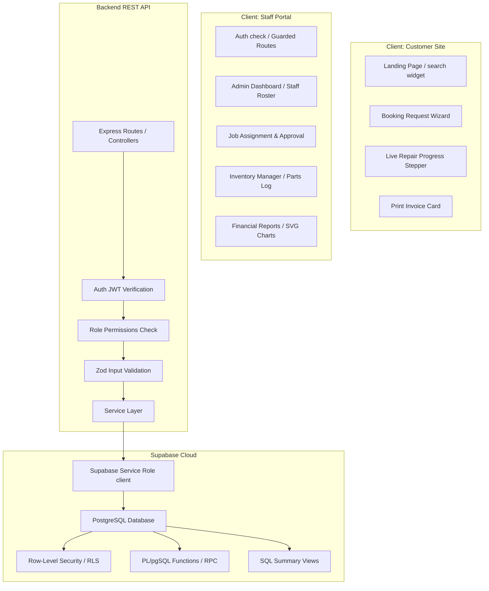

# Architecture Overview — ANM Service Management System (V2)

This document outlines the technical architecture, database design, and key engineering decisions implemented in the **ANM Automotive Service Management System**.

---

## 1. High-Level System Architecture

The ANM system uses a decoupled client-server architecture built on a modern TypeScript stack, with **two separate frontend clients** communicating with a **centralized REST API backend**:



### Flow of Request
1.  **User Action**: The client triggers a request via a specialized helper in `services/` (e.g., `ticketsService`).
2.  **Auth Verification**: For staff-restricted routes, the backend [authenticate](file:///C:/Users/User/Desktop/My%20Learning/ANM/server/src/middleware/auth.ts) middleware intercepts the request, decodes the Supabase JWT header, and attaches the profile to the request context. Public customer routes bypass this guard.
3.  **Role Enforcement**: If the route is restricted (e.g., staff creation is `admin` only), the [requireRole](file:///C:/Users/User/Desktop/My%20Learning/ANM/server/src/middleware/auth.ts) middleware verifies that the user's role matches.
4.  **Input Validation**: Request bodies are validated against strict Zod schemas inside the controllers.
5.  **Database Interactivity**: The service layer interacts with PostgreSQL using the Supabase client. Admin queries utilize the service role key to bypass RLS, while mechanic queries run under context-filtered policies.

---

## 2. Key Design Decisions

### A. Architectural Separation of Frontends
To meet security and performance requirements, the frontend is split into two separate directories:
*   **Customer Portal (`client-customer`)**: A lightweight website containing only unauthenticated views (landing page, booking wizard, tracker, and invoice print-preview). This project compiles down to **236 kB**, improving page speed and search engine optimization (SEO) rankings.
*   **Staff Portal (`client-staff`)**: A secure administrative system containing login, dashboard statistics, active job cards, staff rosters, inventory control, and financial analytics. It compiles to **279 kB**, and redirects any root URL requests to `/login` to prevent unauthorized access.

Both projects share the same design variables via a common styling system ([tokens.css](file:///C:/Users/User/Desktop/My%20Learning/ANM/client-staff/src/styles/tokens.css)).

### B. Invoicing & Settle States (Sprint 9)
When a mechanic updates a ticket status to `completed`, a backend database trigger automatically instantiates an `unpaid` record in the `invoices` table.
*   **Tax Calculations**: Subtotals (parts + labor) automatically compute a 15% VAT contribution (`tax_amount`) and a net total (`total_amount`).
*   **Settlement Flow**: Admins view billing summaries, receive payments, and toggle the status to `paid` specifying the collection method (cash, card, or EFT). This updates the status on the customer's live progress tracker immediately.

### C. Pure SVG Charting (Sprint 10)
Rather than introducing heavy third-party charting dependencies (like Chart.js or Recharts) which would double the bundle size, the staff portal utilizes raw React-rendered SVG elements for data visualization:
*   **Bar Chart**: Draws dynamic `<rect>` tags to show monthly earnings splits.
*   **Donut Chart**: Uses `<circle>` with `strokeDasharray` and `strokeDashoffset` calculations to display Labor vs. Parts revenue proportions.

### D. Payroll Shift Approvals (Sprint 12)
To replace manual physical timesheets, a shift time-tracking mechanism records clock-in/out timestamps. The server calculates decimal durations and total wages based on the technician's stored `hourly_rate`. Admins review logs in a dedicated panel and approve logs, transitioning them to `approved` status for auditing and disbursement. Access controls (Express middleware and Supabase RLS) restrict mechanics to viewing/clocking their own shifts, preventing IDOR/privilege escalation.

### E. IoT Remote Barcode Scanning (Sprint 13)
To avoid expensive hardware installations, technicians connect their personal smartphones as remote barcode scanners. The desktop console generates a secure connection QR code with a unique, registered session ID. The mobile browser scans this code, prompts for password confirmation (re-authentication), and loads a scanning viewport. As barcodes are scanned physically or simulated, the phone transmits them to the server. The desktop polls this registry and automatically populates the target part details (filtering inventory lists or auto-filling parts logging form) in real-time.

---

## 3. Database Schema Relationships

The database is built on a normalized relational layout designed to replace paper-based job cards:

*   **Customers & Vehicles**: A `1:Many` relation. Customers are deduplicated by phone number.
*   **Service Tickets**: The digital job card. It holds foreign keys referencing a `vehicle` (target car), a `staff` mechanic (assigned technician), and a `staff` admin (creator). Includes preference columns for online booking requests.
*   **Invoices**: Automatically created when a ticket status changes to `completed`. Maps net cost, tax, and settlement methods.
*   **Summary Views**:
    *   `monthly_financial_summary`: Aggregates Gross Revenue, Labor Fees, and Parts Billed per month.
    *   `staff_performance_summary`: Ranks mechanics by completed tickets, generated labor, and logged parts.

Refer to the full database diagram and SQL table definitions in [DB_SCHEMA.md](file:///C:/Users/User/Desktop/My%20Learning/ANM/docs/DB_SCHEMA.md).

---

## 4. Folder Structure Rationale

```
anm-system/
├── client-customer/     ← Public Site (Landing, Booking, Track, Invoices)
│   └── src/
│       ├── components/  ← Common UI primitives (Button, Input, Badge, Table)
│       ├── pages/       ← Home.tsx, PublicBooking.tsx, PublicTracker.tsx, PublicInvoice.tsx
│       └── services/    ← ticketsService.ts, invoiceService.ts (Public endpoints only)
├── client-staff/        ← Internal Staff Portal (Login, Dashboard, Inventory, Staff, Invoices, Analytics)
│   └── src/
│       ├── components/  ← Reusable admin layout shells (AppShell, Sidebar)
│       ├── context/     ← AuthContext & protected session managers
│       ├── pages/       ← Dashboard, Tickets, TicketDetail, Inventory, Invoices, Analytics
│       └── services/    ← authService, dashboardService, inventoryService, analyticsService
├── server/              ← Express API server
│   └── src/
│       ├── controllers/ ← Request controllers & body validations (Zod schemas)
│       ├── middleware/  ← Route interceptors (JWT validation, permissions check)
│       └── services/    ← Business logic & database interaction services
└── docs/                ← Architecture, DB Schemas, and QA Test Plans
```
This separation ensures that business logic is completely isolated from controllers, which in turn are isolated from the Express router setup. The clients use structured service layers so views remain purely presentation-focused.
