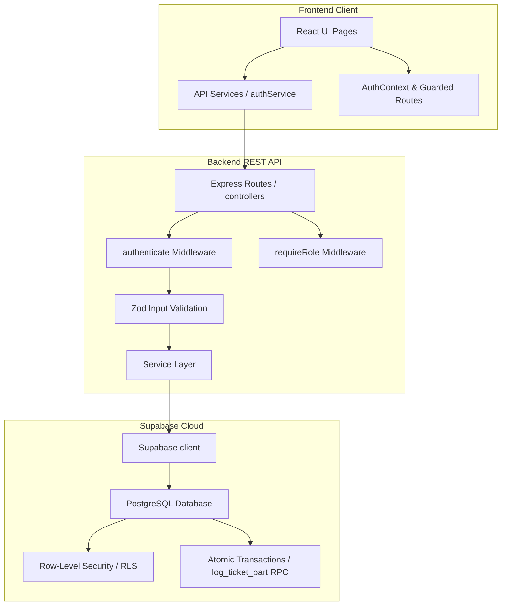

# Architecture Overview — ANM Service Management System

This document outlines the technical architecture, database design, and key engineering decisions implemented in the **ANM Automotive Service Management System**.

---

## 1. High-Level System Architecture

The ANM system uses a decoupled client-server architecture built on a modern TypeScript stack:



### Flow of Request
1. **User Action**: The client triggers a request via a specialized helper in [services/](file:///C:/Users/User/Desktop/My%20Learning/ANM/client/src/services/) (e.g. `ticketService`).
2. **Auth Verification**: The backend [authenticate](file:///C:/Users/User/Desktop/My%20Learning/ANM/server/src/middleware/auth.ts) middleware intercepts the request, decodes the Supabase JWT header, and attaches the profile to the request context.
3. **Role Enforcement**: If the route is restricted (e.g., staff creation is `admin` only), the [requireRole](file:///C:/Users/User/Desktop/My%20Learning/ANM/server/src/middleware/auth.ts) middleware verifies that the user's role matches.
4. **Input Validation**: Request bodies are validated against strict Zod schemas inside the controllers.
5. **Database Interactivity**: The service layer interacts with PostgreSQL using the Supabase client. Admin queries utilize the service role key to bypass RLS, while mechanic queries run with context-specific filters.

---

## 2. Key Design Decisions

### A. TypeScript Across the Stack
By using TypeScript in both `client/` and `server/`, we share model interfaces and domain definitions (such as `Ticket`, `Inventory`, and `Staff`). This eliminates mapping mismatches, guarantees type safety on API request/response boundaries, and simplifies refactoring.

### B. Atomic Database Transactions via PostgreSQL RPC (`log_ticket_part`)
To prevent race conditions during inventory updates (e.g., two mechanics logging parts concurrently), parts deduction is wrapped in a database-level PL/pgSQL transaction function:
- The function locks the inventory row (`SELECT ... FOR UPDATE`) before checking if `qty_in_stock >= qty_used`.
- It decrements `qty_in_stock` and inserts the log into `ticket_parts` in a single atomic transaction.
- If stock is insufficient, it raises a rollback exception. This guarantees database consistency and ensures stock never drops below zero.

### C. Row-Level Security (RLS) as a Hard Boundary
In addition to frontend and backend middleware routing guards, Supabase Row-Level Security (RLS) is enabled on every table. This ensures that even if an attacker bypasses the frontend router or mocks the REST API calls:
- Mechanics can **never** select or update ticket logs assigned to other mechanics.
- Mechanics can **never** access customer records or the staff roster.
- RLS rules are verified directly inside PostgreSQL using the [current_user_role()](file:///C:/Users/User/Desktop/My%20Learning/ANM/docs/DB_SCHEMA.md#L260) helper function.

---

## 3. Authentication & Session Flow

The system integrates Supabase Auth for identity management, coupled with a local `staff` profile table:

1. **Login**: User submits credentials on the login page. The server verifies them against Supabase Auth, retrieves a JWT, looks up the local profile role, and returns both to the frontend.
2. **Client State**: The `AuthContext` caches the JWT and user profile in `localStorage`.
3. **Session Restoration**: On page mount, `AuthContext` makes a check-session call (`GET /api/v1/auth/me`) using the cached token. If valid, the user remains logged in; if expired, the session is cleared.
4. **Route Guarding**:
   - [ProtectedRoute](file:///C:/Users/User/Desktop/My%20Learning/ANM/client/src/components/auth/ProtectedRoute.tsx) shields routes from anonymous access.
   - [RoleRoute](file:///C:/Users/User/Desktop/My%20Learning/ANM/client/src/components/auth/RoleRoute.tsx) prevents mechanics from opening administrative directories, redirecting them back to their assigned jobs dashboard (`/my-jobs`).

---

## 4. Database Schema Relationships

The database is built on a normalized relational layout designed to replace ANM's paper workflow:

- **Customers & Vehicles**: A `1:Many` relation. Customers are deduplicated by phone number.
- **Service Tickets**: The digital job card. It holds foreign keys referencing a `vehicle` (target car), a `staff` mechanic (assigned technician), and a `staff` admin (creator).
- **Inventory**: Tracks stock counts, cost, and reorder alerts.
- **Ticket Parts**: A bridge table resolving the `Many:Many` relationship between `service_tickets` and `inventory`.

Refer to the full database diagram and SQL table definitions in [DB_SCHEMA.md](file:///C:/Users/User/Desktop/My%20Learning/ANM/docs/DB_SCHEMA.md).

---

## 5. Folder Structure Rationale

```
anm-system/
├── client/              ← Vite + React Application
│   └── src/
│       ├── components/  ← Modular reusable UI elements (ui/) & layout modules
│       ├── context/     ← React Context providers (AuthContext)
│       ├── hooks/       ← Custom hooks (useAuth)
│       ├── pages/       ← Route-level page components (Dashboard, Tickets, MyJobs)
│       └── services/    ← API client files (never write inline fetches in pages)
├── server/              ← Express + Node API
│   └── src/
│       ├── config/      ← Database and environment connection configs
│       ├── controllers/ ← Request handers (handles validation and parsing)
│       ├── middleware/  ← Route interceptors (auth, logger, error boundary)
│       └── services/    ← Core business services (interacts with database)
└── docs/                ← Planning, design, and testing markdown files
```
This separation of concerns ensures that business logic is isolated from controllers, which in turn are isolated from the Express router setup. The client uses a structured service layer so pages remain purely display-focused.
