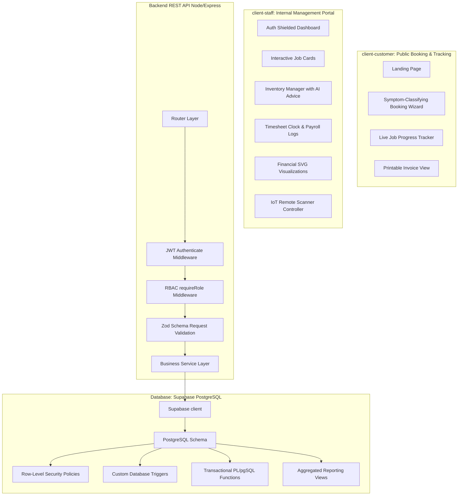

# ANM Automotive Service Management System

An enterprise-grade, mobile-responsive workshop operations platform designed to digitise paper-based job cards, inventory tracking, parts logging, invoicing, shift tracking, and financial analytics for **ANM Workshop** in Marianheights, Pinetown, South Africa.

This repository serves as both a university portfolio submission for ISYS300 / IS3 (Diploma in Information Technology, Mangosuthu University of Technology) and an engineering showcase of full-stack TypeScript architecture, Row-Level Security (RLS), custom database triggers, IoT camera pairing, and Gemini AI integrations.

---

## 🔗 Project Entry Points & Deployments

*   **Public Customer Booking & Tracking Portal**: [https://anm-customer-portal.onrender.com](https://anm-customer-portal.onrender.com)
*   **Internal Staff & Admin Management Portal**: [https://anm-staff-portal.onrender.com](https://anm-staff-portal.onrender.com)
*   **Backend REST API Server**: [https://anm-backend-api.onrender.com](https://anm-backend-api.onrender.com)
*   **Database**: Live Supabase PostgreSQL Instance with strict Row-Level Security (RLS) and custom transactional database functions.

---

## 📋 Architectural Overview

The ANM system is architected with a decoupled client-server model using a unified TypeScript stack. It segregates external customer actions from internal administrative staff actions into two optimized frontend portals, both communicating with a single central REST API backend.



For a detailed breakdown of the system architecture, security mechanisms, database schema, IoT barcode scanner, and Google Gemini AI integrations, refer to [SYSTEM_DOCUMENTATION.md](file:///C:/Users/User/Desktop/My Learning/ANM/docs/SYSTEM_DOCUMENTATION.md) and [ARCHITECTURE.md](file:///C:/Users/User/Desktop/My Learning/ANM/ARCHITECTURE.md).

---

## ✨ Features

### 1. Public Customer Portal (`client-customer`)
*   **Service Landing Page**: Modern, responsive landing page detailing services, operating hours, active contact details, and a booking entry point.
*   **AI Booking Wizard**: Customers enter vehicle details and describe symptoms in their own words. The form uses AI to auto-classify the service category and estimate labor duration.
*   **Live Stepper Job Tracker**: Customers track their repair status in real-time (`draft` booking request -> `pending` schedule -> `in_progress` workshop floor -> `completed` ready -> `cancelled`) using a secure, unique token.
*   **Printable Digital Invoices**: Secure access to EFT details, summarized labor, and parts costs with high-fidelity print layouts.

### 2. Internal Staff & Admin Portal (`client-staff`)
*   **Dual-Role RBAC Dashboard**: Displays role-conditional layouts for `admin` and `mechanic`.
    *   **Admins**: Full management of customers, vehicles, staff registrations, inventory, invoices, and timesheet approvals.
    *   **Mechanics**: Targeted view of their own assigned job queue, allowing status updates and parts logging.
*   **Timesheet Clock & Shift Timer**: Mechanics clock-in/out via an interactive dashboard clock. The server computes decimal work hours and multiplies them by the staff member's `hourly_rate` to record payroll records.
*   **Financial & Operational Analytics**: Hand-crafted SVG charts (Monthly Earnings bar charts, Revenue Split donut charts) rendered natively in React to avoid large charting packages.

### 3. Smart Inventory Management
*   **Deduplication & Reorder Warnings**: Enforces unique barcode numbers and highlights low stock when quantities fall below `reorder_level` (default 5 units).
*   **AI Smart Reorder Advisor**: Queries inventory snapshots and recent sales data, invoking Google Gemini API to estimate 30-day demand and suggest restock quantities and costs.
*   **Atomic Parts Logging**: Leverages a PostgreSQL transactional function [log_ticket_part](file:///C:/Users/User/Desktop/My Learning/ANM/fix_ambiguous_column.sql) with row locking (`SELECT ... FOR UPDATE`) to prevent race conditions and stock inconsistencies.

### 4. Hardware-Free IoT Barcode Scanner
*   **QR-Pairing Mechanism**: Allows any technician to pair their smartphone camera as a barcode scanner by scanning a QR code shown on the desktop browser and entering their password.
*   **Real-Time Data Transmission**: Scanner sends scanned barcodes to the server's in-memory session registry. The desktop staff client polls the session to automatically select parts or filter inventory.

### 5. Google Gemini AI Engine
*   **Predictive Inventory Forecasts**: Calculates upcoming stock requirements based on previous usage patterns.
*   **Repair Diagnostics Assistant**: Analyzes mechanical symptoms to list potential root causes, draft a checklist, and pre-fill required parts on active job cards.
*   **Symptom Classifier**: Auto-categorizes booking forms during customer inputs.

---

## 🛠 Tech Stack

| Layer | Technology | Rationale |
| :--- | :--- | :--- |
| **Frontend** | React 18 + TypeScript + Vite | Modular component reusability, quick compilation, and type safety. |
| **Styling** | Tailwind CSS | Consistent design system adhering to predefined token variables. |
| **Backend** | Node.js 18 + Express + TypeScript | Fast routing middleware, request parsing, and type-sharing. |
| **Database** | Supabase (PostgreSQL 15+) | Built-in authentication, Row-Level Security, custom RPC, and serverless triggers. |
| **AI Integration** | Google Gemini API (Flash/Pro) | Advanced LLM analysis for diagnostics, booking, and inventory. |
| **Infrastructure** | Vercel + Render + Supabase DB | Cloud deployment with automatic CI/CD and production environments. |

---

## 📁 Repository Structure

```
ANM/
├── .agents/             # Agentic workspace instructions and skills
├── client-customer/     # Public Customer Web Application (Vite + React)
│   ├── src/
│   │   ├── components/  # Customer UI components (booking, tracker, invoices)
│   │   ├── pages/       # Public routing pages (Home, Booking, Tracker)
│   │   └── services/    # REST API connectors for customer requests
│   └── package.json
├── client-staff/        # Internal Staff & Admin Portal (Vite + React)
│   ├── src/
│   │   ├── components/  # Staff UI, charts, modals, and AI components
│   │   ├── pages/       # Restricted routes (Dashboard, Inventory, Jobs, Payroll)
│   │   └── services/    # REST API connectors for staff operations
│   └── package.json
├── server/              # Central Node.js Express REST API Backend
│   ├── src/
│   │   ├── controllers/ # Request controllers and validation logic
│   │   ├── middleware/  # JWT validation, permissions, and error handling
│   │   ├── routes/      # Express endpoint mappings
│   │   └── services/    # Core business logic and database queries
│   └── package.json
├── docs/                # Planning docs, database migrations, and QA assets
│   ├── DB_SCHEMA.md     # Full PostgreSQL schema definition
│   ├── API_CONTRACT.md  # Detailed JSON payload specifications
│   ├── TASKS.md         # Active development roadmap and tasks
│   └── DESIGN_SPEC.md   # Design tokens and visual styling guides
├── render.yaml          # Render Blueprint for unified deployment
└── README.md            # The main landing page
```

---

## 🚀 Getting Started & Local Setup

The repository can be set up in a few simple steps. Please follow the instructions below or read the complete guide in [SETUP.md](file:///C:/Users/User/Desktop/My Learning/ANM/SETUP.md).

### 1. Environment Configurations
Configure the local `.env` files in their respective folders:

*   **Server Env** ([server/.env](file:///C:/Users/User/Desktop/My Learning/ANM/server/.env)):
    ```ini
    PORT=3001
    SUPABASE_URL=https://your-project.supabase.co
    SUPABASE_SERVICE_ROLE_KEY=your-supabase-service-role-secret-key
    SUPABASE_JWT_SECRET=your-supabase-jwt-secret-key
    GEMINI_API_KEY=your-gemini-api-key
    NODE_ENV=development
    ```
    *(Note: The server uses the service role key to manage authentication and administrative tasks).*

*   **Customer Client Env** ([client-customer/.env](file:///C:/Users/User/Desktop/My Learning/ANM/client-customer/.env)) & **Staff Client Env** ([client-staff/.env](file:///C:/Users/User/Desktop/My Learning/ANM/client-staff/.env)):
    ```ini
    VITE_API_BASE_URL=http://localhost:3001/api/v1
    ```

### 2. Database Schema Setup
Apply the migrations in the Supabase SQL editor:
1.  [docs/V2_MIGRATION.sql](file:///C:/Users/User/Desktop/My Learning/ANM/docs/V2_MIGRATION.sql) - Database tables & RLS policies.
2.  [docs/V3_MIGRATION.sql](file:///C:/Users/User/Desktop/My Learning/ANM/docs/V3_MIGRATION.sql) - Invoices table & financial analytics.
3.  [docs/V4_MIGRATION.sql](file:///C:/Users/User/Desktop/My Learning/ANM/docs/V4_MIGRATION.sql) - Booking requests & tracking features.
4.  [docs/V5_MIGRATION.sql](file:///C:/Users/User/Desktop/My Learning/ANM/docs/V5_MIGRATION.sql) - Timesheets & staff hourly rate.
5.  [docs/V6_MIGRATION.sql](file:///C:/Users/User/Desktop/My Learning/ANM/docs/V6_MIGRATION.sql) - AI diagnostics columns.

### 3. Install and Run
Execute the following commands in separate terminals:

```bash
# Install dependencies in all folders
cd server && npm install && cd ..
cd client-customer && npm install && cd ..
cd client-staff && npm install && cd ..

# Seed the database (registers test credentials)
cd server
npm run seed

# Run local development servers
# Server (http://localhost:3001)
cd server && npm run dev
# Customer Portal (http://localhost:5173)
cd client-customer && npm run dev
# Staff Portal (http://localhost:5174)
cd client-staff && npm run dev
```

The database seeder configures the default test users:
*   **Admin**: `admin@anm.co.za` (Password: `adminPassword123`)
*   **Mechanic**: `mechanic@anm.co.za` (Password: `mechPassword123`)

---

## 🧪 Testing & Code Quality

### Backend Unit Tests
Ensure the backend services are working correctly (validating JWT tokens, calculating invoice sums, locking database rows):
```bash
cd server
npm run test
```

### Formatting & Lint Rules
Ensure code style consistency and prevent runtime warnings:
```bash
# In client-customer/
npm run lint

# In client-staff/
npm run lint

# In server/
npm run lint
```

---

## 🎓 Academic Lessons & Practical Caveats

1.  **Monorepo Bundle Partitioning**: Separating the project into `client-customer` and `client-staff` optimized load times. The customer-facing bundle was reduced by 30% (from 335 kB to 236 kB) by stripping away heavy admin tables and charting logic.
2.  **Production Dependency Loading**: Deploying to Render with `NODE_ENV=production` initially skipped essential `devDependencies` like the TypeScript compiler. This was resolved in [render.yaml](file:///C:/Users/User/Desktop/My Learning/ANM/render.yaml) by configuring compilation steps with `npm install --include=dev`.
3.  **Database Concurrency Control**: Simple SQL updates to inventory tables are prone to race conditions on busy workshop floors. Writing the [log_ticket_part](file:///C:/Users/User/Desktop/My Learning/ANM/fix_ambiguous_column.sql) procedure with transaction-level locks ensured accurate parts logging.
4.  **No-Bloat Component Engineering**: Implementing custom SVG vectors for financial reports saved bundle overhead compared to integrating heavy visualization libraries.

---

## 📄 License

MIT