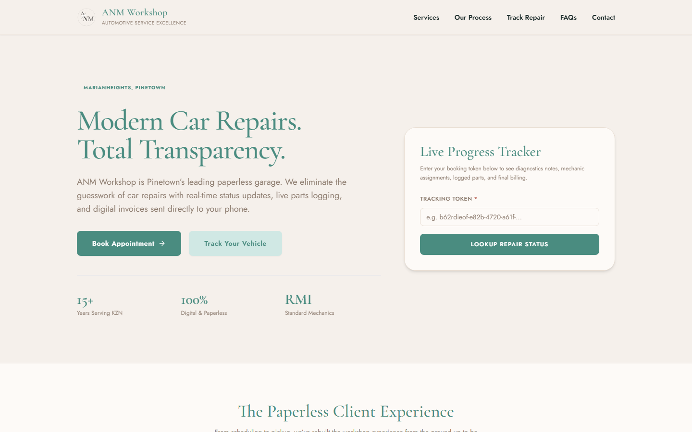
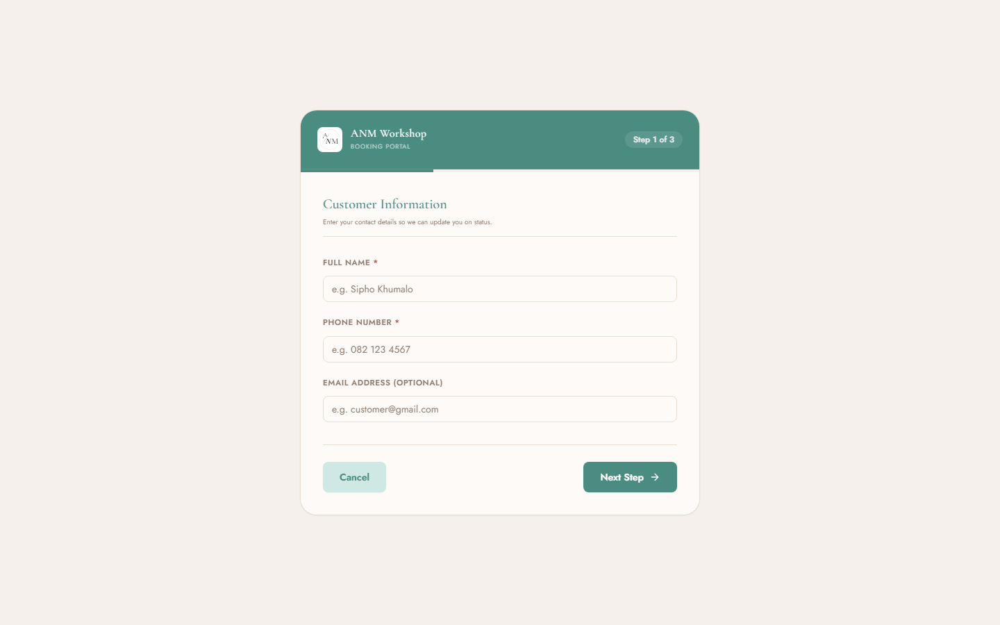
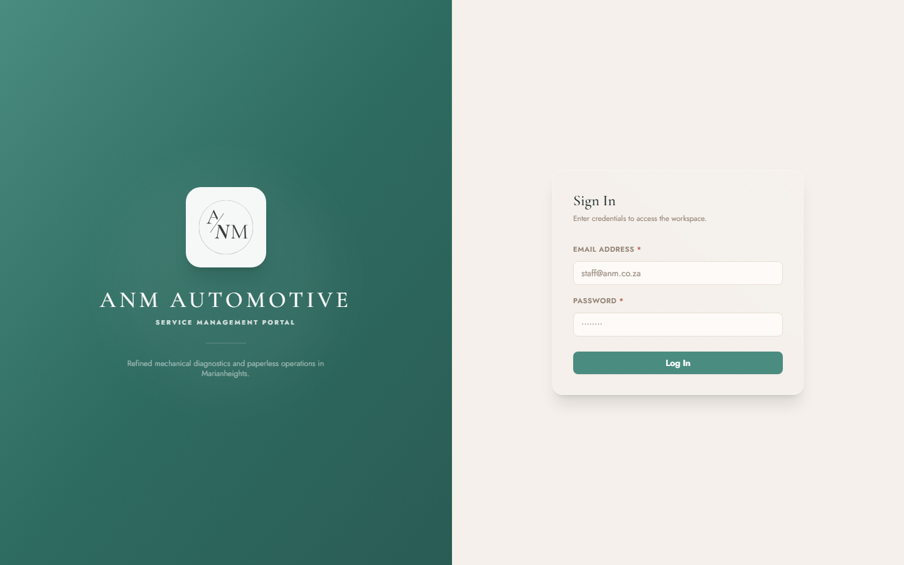
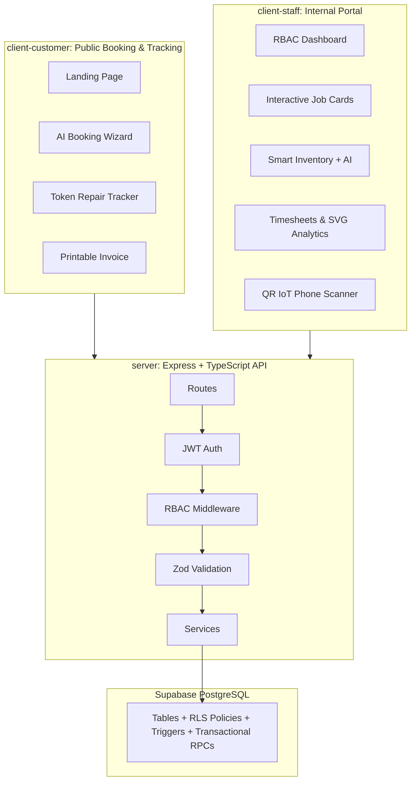

<div align="center">
  
  <h1>ANM Automotive Service Management System</h1>
  <p>
    <strong>Full-stack workshop operations platform digitising job cards, parts inventory, invoicing, shift payroll, IoT barcode pairing, and Gemini AI diagnostics.</strong>
  </p>

  <p>
    
    
    
    
    
    <a href="LICENSE"></a>
  </p>

  <p>
    <a href="https://anm-customer-portal.onrender.com">Live Customer Portal</a> •
    <a href="https://anm-staff-portal.onrender.com">Live Staff Portal</a> •
    <a href="#-screenshots">Screenshots</a> •
    <a href="#-features">Features</a> •
    <a href="#%EF%B8%8F-architecture--tech-stack">Architecture</a> •
    <a href="#-getting-started">Getting Started</a>
  </p>
</div>

---

## What Is ANM?

**ANM Automotive Service Management System** replaces paper-based job cards and manual stock sheets for **ANM Workshop** in Marianheights, Pinetown, South Africa.

It separates public customer workflows (service booking, token-based live repair tracking, digital invoices) from internal workshop operations (interactive job cards, atomic parts logging, shift clock & payroll, financial SVG charts, QR-paired smartphone barcode scanning, and Gemini AI diagnostics) behind a shared **Express + TypeScript** API and **Supabase PostgreSQL** with Row-Level Security (RLS).

---

## 🌐 Live Deployments

| Surface | URL | Purpose |
| --- | --- | --- |
| **Customer Portal** | [anm-customer-portal.onrender.com](https://anm-customer-portal.onrender.com) | Public landing page, symptom-classifying booking wizard & token repair tracker |
| **Staff & Admin Portal** | [anm-staff-portal.onrender.com](https://anm-staff-portal.onrender.com) | Authenticated portal for mechanics & admins (job cards, parts, payroll, analytics) |
| **REST API Server** | [anm-backend-api.onrender.com](https://anm-backend-api.onrender.com) | Central TypeScript Express API enforcing JWT auth, RBAC & Zod validation |

---

## 📱 Screenshots

<table>
  <tr>
    <td align="center" width="50%">
      <br />
      <sub><strong>Customer Portal</strong> — Service landing page &amp; token-based live repair lookup</sub>
    </td>
    <td align="center" width="50%">
      <br />
      <sub><strong>Booking Wizard</strong> — Multi-step vehicle &amp; symptom intake</sub>
    </td>
  </tr>
  <tr>
    <td align="center" colspan="2">
      <br />
      <sub><strong>Staff &amp; Admin Portal</strong> — Role-gated workspace for job cards, inventory, payroll &amp; analytics</sub>
    </td>
  </tr>
</table>

---

## ✨ Features

### Public Customer Portal (`client-customer`)
- **AI Booking Wizard**: Customers describe vehicle symptoms in plain language; Gemini AI classifies the service category and estimates labor duration.
- **Token-Based Live Tracker**: Instant repair progress stepper (`draft` → `pending` → `in_progress` → `completed`) without forcing account creation.
- **Digital Invoices**: Printable customer invoices summarizing labor, parts logged, and EFT payment details.

### Internal Staff & Admin Portal (`client-staff`)
- **Dual-Role RBAC (`admin` / `mechanic`)**: Admins manage customers, vehicles, staff, inventory, invoices, and payroll approvals; mechanics work through assigned job cards and log parts.
- **Atomic Parts Logging**: PostgreSQL transactional RPC (`log_ticket_part`) with row locking (`SELECT ... FOR UPDATE`) prevents stock race conditions.
- **Hardware-Free IoT Barcode Scanner**: Technicians pair a smartphone camera via QR code to scan part barcodes directly into desktop job cards and inventory.
- **Shift Timesheets & Native SVG Analytics**: Clock-in/out shift tracking with automatic payroll math and zero-dependency SVG earnings and revenue charts.
- **Gemini AI Diagnostics & Reorder Advisor**: Suggests root causes and parts checklists from symptoms and forecasts 30-day stock restock demand.

---

## 🛠️ Architecture & Tech Stack



| Layer | Technology |
| --- | --- |
| **Frontends** | React 18, TypeScript, Vite, Tailwind CSS |
| **Backend API** | Node.js, Express, TypeScript, Zod validation |
| **Database & Security** | Supabase PostgreSQL (RLS policies, triggers, transactional RPCs), JWT + RBAC |
| **AI & Email** | Google Gemini API (diagnostics & inventory forecasting), Resend |
| **Deployment** | Render Blueprint ([`render.yaml`](render.yaml)) |

### Project Structure

```text
ANM/
├── client-customer/     # Public booking, live repair tracker & invoice React app
├── client-staff/        # Authenticated mechanic & admin portal
├── server/              # Express + TypeScript REST API, JWT/RBAC middleware & services
├── docs/                # Architecture, DB schema, API contract & SQL migrations (V2–V6)
├── ARCHITECTURE.md      # Deep-dive system architecture notes
├── SETUP.md             # Full setup & seed credential guide
└── render.yaml          # Multi-service Render deployment blueprint
```

---

## 🚀 Getting Started

### Prerequisites
- **Node.js 18+**
- A **Supabase** PostgreSQL project (run migrations `docs/V2_MIGRATION.sql` through `docs/V6_MIGRATION.sql` in the SQL Editor)

### 1. Clone & Configure Environment
```bash
git clone https://github.com/KevinAsanda/ANM.git
cd ANM
cp server/.env.example server/.env
cp client-customer/.env.example client-customer/.env
cp client-staff/.env.example client-staff/.env
```
Fill in `SUPABASE_URL`, `SUPABASE_SERVICE_ROLE_KEY`, `SUPABASE_JWT_SECRET`, and `GEMINI_API_KEY` in `server/.env`.

### 2. Install, Seed & Run
```bash
cd server && npm install && npm run seed && npm run dev
cd ../client-customer && npm install && npm run dev
cd ../client-staff && npm install && npm run dev
```

### 3. Run Tests & Linting
```bash
cd server && npm test
```

> See [`SETUP.md`](SETUP.md) and [`ARCHITECTURE.md`](ARCHITECTURE.md) for full database migration and deployment instructions.

---

## 📄 License

Distributed under the **MIT License**. See [`LICENSE`](LICENSE) for details.
