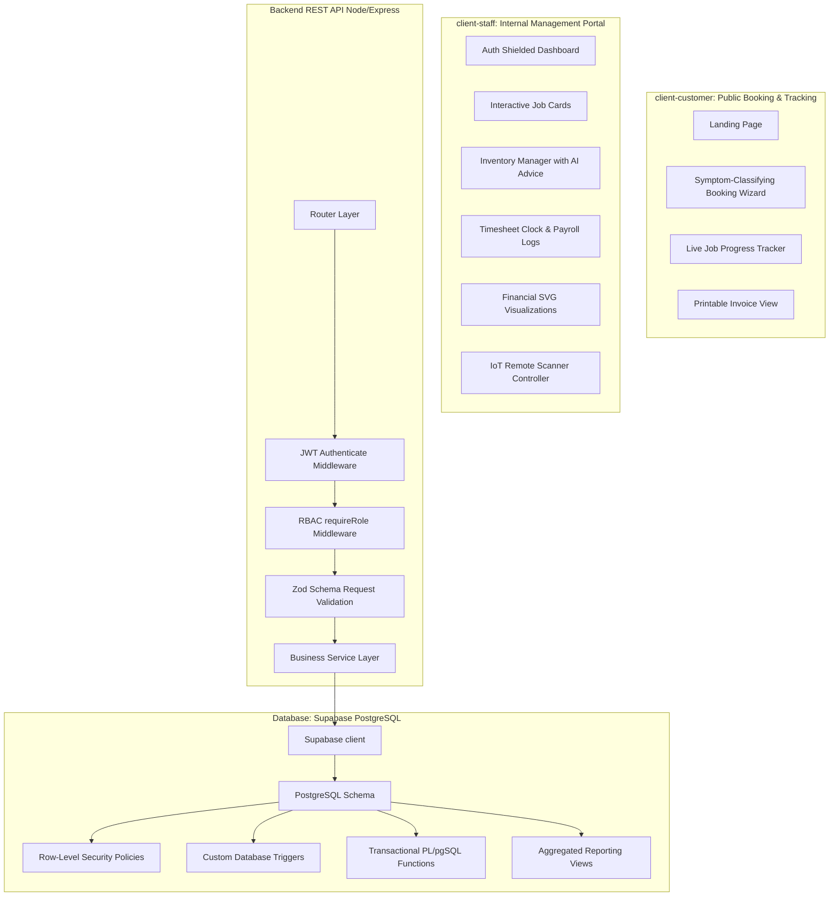
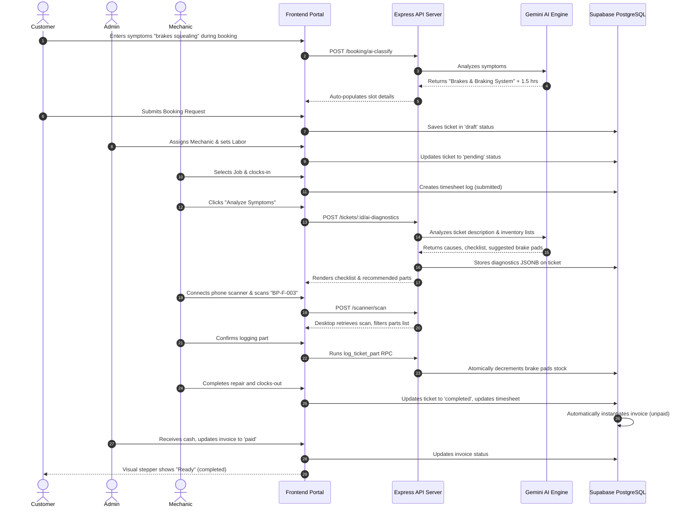

# SYSTEM DOCUMENTATION — ANM Automotive Service Management System

This document provides a comprehensive technical overview of the architectural design, security mechanisms, database schema, and advanced IoT/AI integrations implemented in the **ANM Automotive Service Management System** (V2).

---

## 1. High-Level Architecture & Tech Stack

The ANM system is designed with a modern decoupled client-server architecture using a unified TypeScript stack. It segregates external customer actions from internal administrative staff actions into two optimized frontend portals, both communicating with a single central REST API backend.



### Technical Stack Details

*   **Frontend (Portals)**: React 18, TypeScript, and Vite.
    *   **Customer Portal (`client-customer`)**: A public-facing web app tailored for customer actions. Compiles to a lightweight size of **236 kB**, enhancing search engine optimization (SEO) and page speeds.
    *   **Staff Portal (`client-staff`)**: A secure administrative panel handling mechanics' work cards, inventory control, and financial operations. Compiles to **279 kB** with root routes guarded behind login checks.
    *   **Styling**: Vanilla Tailwind CSS mapping directly to design tokens defined in [tokens.css](file:///C:/Users/User/Desktop/My%20Learning/ANM/client-staff/src/styles/tokens.css).
*   **Backend REST API**: Node.js 18, Express, and TypeScript. Acts as a gatekeeper, processing input validation, business logic, and database operations.
*   **Cloud Database**: Supabase (PostgreSQL 15+) with Row-Level Security (RLS) policies enforcing role checks at the database layer.
*   **Communications & APIs**: Fetch API services on the clients; Express JSON routes on the backend.
*   **Deployment**: Vercel (Frontend portals) and Render (Express backend API).

---

## 2. Login, Authentication & Authorization

Securing workshop operations and financial data is handled through a strict authentication and Role-Based Access Control (RBAC) hierarchy.

### Authentication Flow
1.  **Staff Credentials**: Users submit their email and password through the Login page on the staff portal. The input is handled by [LoginForm.tsx](file:///C:/Users/User/Desktop/My%20Learning/ANM/client-staff/src/components/auth/LoginForm.tsx) which calls `authService.login()`.
2.  **Supabase Auth**: The client invokes the Supabase authentication provider. Upon validation, Supabase returns a JSON Web Token (JWT) representing the user session.
3.  **Token Retention**: The JWT is stored in local storage and appended as a `Bearer <token>` HTTP header in all subsequent API requests.

### Backend Authorization Middleware
All staff-restricted Express endpoints pass through authentication guards defined in [auth.ts](file:///C:/Users/User/Desktop/My%20Learning/ANM/server/src/middleware/auth.ts):
*   **`authenticate`**:
    *   Extracts the Bearer JWT from the `Authorization` header.
    *   Uses a dedicated, privileged Supabase client (`authClient` initialized with the backend-only `SUPABASE_SERVICE_ROLE_KEY`) to call `authClient.auth.getUser(token)`. This decodes the JWT and verifies its signature without polluting the global client session.
    *   Queries the `staff` table using the decoded `user.id` to retrieve the staff profile.
    *   Attaches the profile (ID, name, email, role) to the Express request context (`req.user`).
*   **`requireRole(allowedRole)`**:
    *   Checks `req.user.role`. If the role does not match (e.g. a mechanic attempting to access admin-only analytics), it halts execution immediately and responds with `403 Forbidden`.

### Database Row-Level Security (RLS)
Security is enforced at the database level so that compromise of the API key cannot bypass access controls. RLS is enabled on every table in [DB_SCHEMA.md](file:///C:/Users/User/Desktop/My%20Learning/ANM/docs/DB_SCHEMA.md).
*   **SQL Role Extraction**: The database defines a helper function `current_user_role()` mapping to the logged-in JWT user:
    ```sql
    CREATE OR REPLACE FUNCTION current_user_role()
    RETURNS text AS $$
      SELECT role FROM staff WHERE id = auth.uid();
    $$ LANGUAGE sql SECURITY DEFINER;
    ```
*   **Policy Enforcement**:
    *   `staff`: Accounts can view their own rows; admins can view all.
    *   `service_tickets`: Admins have full access. Mechanics can only `SELECT` or `UPDATE` tickets where `staff_id = auth.uid()`.
    *   `inventory`: Mechanics can select (read-only) parts. Admins have complete CRUD access.
    *   `ticket_parts`: Mechanics can only query or write parts logged on tickets assigned to them.
    *   `invoices`: Restricted entirely to admins.

---

## 3. Database Schema & Entity Relationships

The relational model replaces the workshop's paper-based records. It links customers, vehicles, tickets, parts, invoices, and timesheets.

```
                  ┌───────────────┐
                  │   customers   │
                  └───────┬───────┘
                          │ 1
                          │
                          │ M
                  ┌───────▼───────┐
                  │   vehicles    │
                  └───────┬───────┘
                          │ 1
                          │
                          │ M
  ┌──────────────┐        │               ┌──────────────┐
  │    staff     ├────────┼───────────────►    invoices  │
  └──────┬───────┘ 1      │ M             └──────────────┘
         │                │                      ▲
         │ 1              │                      │ 1:1
         │         ┌──────▼───────┐              │
         ├─────────►service_tickets──────────────┘
         │         └──────┬───────┘
         │ M              │ 1
         │                │
         │         ┌──────▼───────┐        ┌──────────────┐
         └─────────► ticket_parts ◄────────┤  inventory   │
                   └──────────────┘ M    1 └──────────────┘
```

### Core Schema Tables (Detailed)

1.  **`customers`**: Holds details for customers. Uniquely indexed on `phone` for rapid checks during bookings.
2.  **`vehicles`**: Tracks vehicle info, referencing `customer_id`. Uniquely indexed on `registration_number`.
3.  **`staff`**: Extends the `auth.users` schema. Holds the name, email, and role (`admin` or `mechanic`) of workshop staff.
4.  **`service_tickets`**: Replaces the paper job card. Integrates with vehicles and staff. Holds preferred scheduling dates and a unique `tracking_token` for customer public access. Includes an `ai_diagnostics` JSONB column.
5.  **`inventory`**: Tracks spare parts, stock levels, and costs. Low-stock warning is checked against a dynamic `reorder_level` (defaulting to 5 units).
6.  **`ticket_parts`**: A bridge table representing the many-to-many relationship between service tickets and parts. Captures a snapshot of the unit cost at the moment of logging (`unit_cost_at_time`) to preserve historical accounting logs.
7.  **`invoices`**: Billing details automatically generated when a ticket is completed. Contains parts sums, labor fees, a 15% South African VAT computation, and a payment status state.
8.  **`timesheets`**: Tracks payroll shift hours based on clock-in and clock-out logs. It computes `total_pay` dynamically based on the technician's `hourly_rate`.

### Database Transactions & Triggers
To prevent race conditions when multiple mechanics log parts simultaneously, the database employs a transactional function `log_ticket_part` defined in [DB_SCHEMA.md](file:///C:/Users/User/Desktop/My%20Learning/ANM/docs/DB_SCHEMA.md):
*   **Row-Level Locking**: Uses a `SELECT ... FOR UPDATE` query targeting the specific `inventory` item. This blocks subsequent updates to the row until the transaction commits, preventing double-allocation of stock.
*   **Validation**: Verifies stock availability. If insufficient, it throws an exception `Insufficient stock.` and aborts.
*   **Execution**: Updates inventory quantities, registers the entry in `ticket_parts`, and returns the logged part profile.

---

## 4. Key Functional Features & Workflows

### Service Booking & Digital Job Cards
*   **Customer Booking Wizard**: Public clients enter vehicle details, contact information, and mechanical symptoms. Symptoms are analyzed in real-time by AI (see Section 6) to pre-select service categories.
*   **Admin Assignment**: Booking requests land in a `draft` state. Admins review bookings on their dashboard, assign a mechanic, set the preliminary labor fees, and schedule the booking, which shifts the ticket state to `pending`.
*   **Mechanic Execution**: The ticket is displayed in the mechanic's "My Jobs" roster. The mechanic moves the ticket to `in_progress` once work starts, logs parts, and marks the ticket as `completed` upon finishing the repairs.

### Invoicing & Financial Settlement
*   **Trigger-Based Generation**: Once a ticket status transitions to `completed`, a backend service automatically compiles the labor charges and parts costs to instantiate a new record in `invoices`.
*   **Tax Engine**: Subtotals automatically compute a 15% VAT addition (`tax_amount`) and a net total (`total_amount`).
*   **Settlement**: Admins check the unpaid invoices tab, log collections (Cash, Card, or EFT), and update the status to `paid`. This update is immediately reflected on the customer's live tracking stepper.

### Payroll Time-Tracking
*   **Technician Controls**: Mechanics clock in and out from a ticking stopwatch panel in their staff workspace. This registers clock timestamps in the `timesheets` table.
*   **Wage Computation**: Upon clocking out, the server calculates the decimal difference in hours and multiplies it by the mechanic's stored `hourly_rate` to calculate the shift's `total_pay`.
*   **Admin Audits**: Timesheets are saved in a `submitted` status. Admins review them via the `/payroll` page, approving them for disbursement which transitions the status to `approved`.

### Pure SVG Charting
To avoid the load of third-party charting libraries, the analytics module uses React-rendered SVG elements:
*   **Earnings Trend**: Combines `<rect>` tags positioned within an SVG viewport to display month-on-month labor vs. parts revenue splits.
*   **Revenue Split**: Calculates `strokeDasharray` and `strokeDashoffset` dynamically on a `<circle>` SVG element to construct a donut chart comparing labor fees to parts margins.

---

## 5. IoT Remote Barcode Scanning

To provide inventory tracking without specialized hardware, the system allows technicians to pair their mobile devices as barcode scanners.

```
  ┌─────────────────┐                       ┌──────────────┐
  │  Desktop Client ├───────────────────────►  REST API    │
  │  (Staff Portal) │   1. Register Session │  Backend     │
  └────────▲────────┘                       └──────▲───────┘
           │                                       │
           │ 4. Poll scanner/poll                  │ 3. Post scanner/scan
           │                                       │
  ┌────────┴────────┐                       ┌──────┴───────┐
  │  Mobile Device  │   2. QR Scan Link     │  Mobile Web  │
  │  (Technician)   ├───────────────────────►  Scanner App │
  └─────────────────┘                       └──────────────┘
```

### How the Integration Works

1.  **Session Registration**: When an admin or mechanic clicks "Connect Phone Scanner" in the staff portal, the desktop client generates a unique `sessionId` (UUID) and registers it on the backend via:
    `POST /api/v1/scanner/register`
    which saves a blank session placeholder in the server's in-memory registry:
    ```typescript
    // server/src/controllers/scanner.controller.ts
    const activeSessions: Record<string, ScanSession> = {};
    ```
2.  **QR Code Connection**: The desktop displays a QR code encoding a secure connection URL pointing to the staff portal's mobile scanner view:
    `/scanner-session?sessionId=<id>&email=<email>`
3.  **Secure Pairing**: The technician scans the QR code with their mobile device. To prevent unauthorized access, the mobile browser forces the user to confirm their login password. Upon validation, the page mounts a scanning portal utilizing the device's camera via the `html5-qrcode` library.
4.  **Simulated / Physical Scans**:
    *   **Physical**: The technician points their phone camera at a part's barcode.
    *   **Simulated**: A list of workshop inventory items is available as click buttons to simulate scanner inputs in testing environments.
5.  **Data Transmission**: Once a barcode is captured, the mobile browser sounds a beep and submits it to the API:
    `POST /api/v1/scanner/scan`
    which updates the session in the backend in-memory registry:
    ```typescript
    session.barcode = barcode;
    session.scannedAt = new Date().toISOString();
    ```
6.  **Desktop Reception**: The desktop client polls the server:
    `GET /api/v1/scanner/poll?sessionId=<id>`
    at a short interval (e.g., 1000ms). When a barcode is retrieved, the server clears the session's barcode state to prevent repeat actions. The desktop then handles the incoming string:
    *   **Inventory Page**: Auto-fills the search bar with the scanned barcode, displaying the item. If not found, it prompts to create the part using that barcode.
    *   **Ticket Parts Form**: Automatically selects the logged part in the dropdown, allowing the mechanic to quickly confirm the quantity and log it to the active job card.

For details on the scanner controllers and components, refer to [scanner.controller.ts](file:///C:/Users/User/Desktop/My%20Learning/ANM/server/src/controllers/scanner.controller.ts) and [MobileScannerModal.tsx](file:///C:/Users/User/Desktop/My%20Learning/ANM/client-staff/src/components/inventory/MobileScannerModal.tsx).

---

## 6. AI Integrations (Google Gemini API)

The system leverages the Google Gemini API (orchestrated via [ai.service.ts](file:///C:/Users/User/Desktop/My%20Learning/ANM/server/src/services/ai.service.ts)) to provide intelligence across booking, diagnostics, and inventory management. If no API key is configured in the environment, the server falls back to an offline rule-based mock engine.

### AI Feature Details

#### A. Predictive Inventory Demand & Smart Reordering
*   **API Endpoint**: `GET /api/v1/inventory/ai-forecast`
*   **Operational Flow**:
    *   Queries all current inventory items and the entire historical `ticket_parts` logging records.
    *   Compiles a prompt containing the inventory snapshot and usage histories over the last 30-90 days.
    *   Instructs Gemini to project 30-day demand and suggest restock amounts.
    *   Returns a structured JSON response specifying:
        *   `inventory_id` / `part_name`
        *   `projected_demand` (units estimated to be used in next 30 days)
        *   `suggested_order_qty`
        *   `estimated_cost` (suggested quantity * unit cost)
        *   `reasoning` (business explanation for the order)
*   **UI Integration**: Displays as a prominent panel on the Inventory List screen. Admins click "Restock" to open a confirmation modal. To maintain human-in-the-loop oversight, admins can manually override suggested quantities before saving.

#### B. AI-Powered Repair Diagnostics & Parts Suggester
*   **API Endpoint**: `POST /api/v1/tickets/:id/ai-diagnostics`
*   **Operational Flow**:
    *   Reads the ticket description along with all available workshop parts.
    *   Prompts Gemini to analyze the issue and return:
        1.  Top 3 likely causes of the problem.
        2.  A step-by-step diagnostic checklist.
        3.  Recommended parts matching the active inventory IDs.
    *   The backend saves the generated JSON structure in the `ai_diagnostics` JSONB column of the ticket.
*   **UI Integration**: Displays on the Ticket Detail page. Mechanics can tick checklist items, which immediately calls the checklist PATCH endpoint to save status. Clicking "Add to Job" on suggested parts pre-fills the Log Part Form, enabling fast logging.

#### C. Smart Booking Assistant & Service Categorizer
*   **API Endpoint**: `POST /api/v1/public/booking/ai-classify`
*   **Operational Flow**:
    *   Monitors the customer's input description in the public booking wizard.
    *   On keystroke pause, it posts the description text to the AI endpoint.
    *   AI classifies the symptoms into a category (e.g. "Suspension & Steering") and estimates the decimal labor hours.
*   **UI Integration**: Pre-selects the category dropdown in the booking form and displays the estimated labor duration. Customers can manually override the category if desired.

---

## 7. Configuration & Environment Variables

Proper separation of keys ensures client bundles do not expose administrative privileges.

### Server Environment (`server/.env`)
```ini
PORT=3001
SUPABASE_URL=https://your-project.supabase.co
SUPABASE_SERVICE_ROLE_KEY=your-service-role-key # Keep strict secret; bypasses RLS
JWT_SECRET=your-jwt-secret
GEMINI_API_KEY=your-gemini-api-key             # Triggers production AI features
GEMINI_MODEL=gemini-flash-latest                # Defaults to flash
NODE_ENV=development
```

### Staff Client Environment (`client-staff/.env`)
```ini
VITE_API_BASE_URL=http://localhost:3001/api/v1
VITE_SUPABASE_URL=https://your-project.supabase.co
VITE_SUPABASE_ANON_KEY=your-anon-key           # Restrained by RLS policies
```

### Customer Client Environment (`client-customer/.env`)
```ini
VITE_API_BASE_URL=http://localhost:3001/api/v1
VITE_SUPABASE_URL=https://your-project.supabase.co
VITE_SUPABASE_ANON_KEY=your-anon-key
```

---

## 8. Summary of Component Integration

The following diagram illustrates how these features interact in real-world scenarios:


